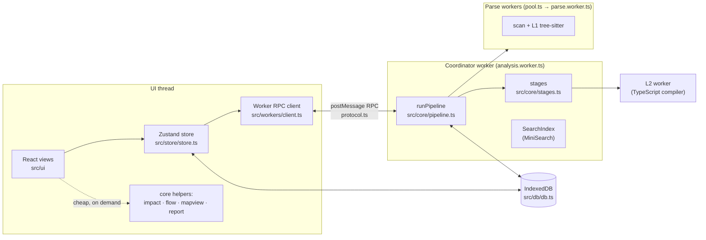

# Architecture

imex (formerly C-Ray) is a **static site**. There is no backend: ingestion, parsing, analysis, persistence and export all
happen in the browser tab. The same analysis code also runs in Node for tests and benchmarks.

## Layers at a glance

## Directory map

| Path | Owns | Notes |
|---|---|---|
| `src/core/` | All analysis logic. **Isomorphic**: no DOM. | Runs in workers and in Node tests. |
| `src/core/types.ts` | The `Analysis` model and every shared type. | Bump `ANALYSIS_VERSION` on breaking shape changes. |
| `src/core/pipeline.ts` | `runPipeline`: ingest → per-file scan/L1 (cached) → L0 → plugged-in stages → snapshots. | Each stage wrapped in `time()`: failures become notices. |
| `src/core/stages.ts` | The ordered stage list (`defaultStages`) + `gitStage`. | Add new analysis here. |
| `src/core/ingest/` | Reading files/folders/ZIPs, ignore rules, binary/minified/generated detection, budgets. | Skips are recorded with a reason. A shared root folder is stripped, except for memory sources with `keepPaths` (git snapshots). |
| `src/core/packages.ts` | `workspacePackages`: package.json names + entry (`source`/`main`/`module`/`exports["."]`) for L1 and L2 resolution. | D31 |
| `src/core/l0/` | L0: languages, LOC, manifests, configs, docs, tech-stack detection. | No parsing needed. |
| `src/core/l1/` | L1: tree-sitter extraction (13 grammars) + heuristic import/call resolver. | Confidence `heuristic` unless proven. |
| `src/core/l2/tsgraph.ts` | L2: TypeScript compiler API program → exact defs/imports/refs for TS/JS. | Replaces L1 for those files (D13). |
| `src/core/graph.ts` | Stages `l1Stage`, `l2Stage`, `accuracyStage` (L1-vs-L2), `assembleStage`. | Builds `symbols / imports / refs`. |
| `src/core/detect/` | Framework detectors (Express, Fastify, Nest, Next, React, Django, Flask, FastAPI, Spring, Laravel, PHP pages, Rails, Go http, ASP.NET) + generic facts. | Regex/line scanners + symbol table (D15). |
| `src/core/flow.ts` | Request/flow tracer from an entry point. | Called by the UI on demand. |
| `src/core/schema.ts` | Data-model reconstruction from 11 ORM/DDL sources, ER → Mermaid, entity read/write map. | SQL via hand tokenizer (D3). |
| `src/core/deps.ts` | Cycles, coupling metrics, god modules, layering violations, packages. | |
| `src/core/health.ts`, `scan.ts` | Findings: size, complexity, nesting, clones, dead exports, TODOs, secrets, eval, SQL concat, TLS. | |
| `src/core/impact.ts` | Transitive dependents, affected entries/tests, risk score. | Called by the UI on demand. |
| `src/core/git/` | `analyze.ts`: history from an uploaded `.git` via isomorphic-git over an in-memory FS (`memfs.ts`): churn, authors, bus factor, co-change (+ `linked`, D29/D31), renames (D32, history merged under the current name), message types, snapshots (D30), hotspot findings. `diff.ts`: `diffSnapshots` for time-travel (no isomorphic-git import, so the UI and report can use it). | Loaded lazily by `gitStage`. |
| `src/core/orientation.ts`, `roles.ts` | Summary, architecture-style guesses, "read these first", file roles. | Re-run after each phase. |
| `src/core/viz/` | Pure layout maths for the U3 pictures: `treemap.ts` (file tree + squarified layout), `matrix.ts` (DSM grouping, SCCs, ordering, cycle/violation cells), `calendar.ts` (commit days + author weeks), `scatter.ts` (hotspot map), `path.ts` (shortest import path), `radial.ts` (rings, circle), `er.ts` (ER card grid + clipped lines), `progress.ts` (pipeline phase → stepper step). | D37. Called by the UI on demand; bounded. |
| `src/core/decisions/` | `catalogue.ts`: one detector per decision kind (D40) over the finished analysis; `docs.ts`: ADR parser (Nygard + MADR) and README rationale finder; `index.ts`: `decisionsStage`. | `deep` stage after deps, health and git. |
| `src/core/onboarding/` | `index.ts`: reading path, first-week checklist, `onboardingStage`; `run.ts`: commands, env, ports, prerequisites from manifests/Dockerfile/Makefile/README; `glossary.ts`: domain terms. | D41. Needs file text, so it runs in the worker and is stored. |
| `src/core/report.ts` | Markdown / Notion pages / diagrams for export. | |
| `src/core/search.ts` | Symbol + full-text search index. | Built lazily in the coordinator. |
| `src/core/node-env.ts` | Node implementation of the pipeline environment (tests/bench). | |
| `src/workers/` | `analysis.worker.ts` (coordinator), `pool.ts` + `parse.worker.ts` (parsing), `l2.worker.ts`, `protocol.ts`, `client.ts`. | |
| `src/db/db.ts` | IndexedDB stores: `projects`, `analyses`, `sources`, `cache`, `settings`, `handles`. | Retention + quota handling. |
| `src/store/store.ts` | Single Zustand store: app status, settings, current analysis, tab, source panel, cross-view focus. | |
| `src/ui/` | React views (one per tab), `kit.tsx` (shared components, `PageGroup` context, `listKeys`), `Graph.tsx` (Cytoscape + zoom/legend/minimap/export overlays, colours from tokens, D35; motion, highlight, travelling dot and locate pulse, D38), `Mermaid.tsx` (base theme from tokens), `SourcePanel.tsx`, `motion.ts` (reduced-motion check, View Transitions, count-up; D36), `icons.ts` (lucide icon per tab), `Logo.tsx`, `sample.ts` (bundled sample project, lazy chunk), `markdown.ts` (report Markdown → HTML: raw HTML escaped, unsafe URL schemes dropped; DOM-free, unit-tested). `viz/` holds the SVG pictures (Treemap, Breakdown, Matrix, HotspotMap, Calendar, …) and `viz/common.ts` (`useWidth`, `tipAt`, `fit`). | |
| `scripts/copy-assets.mjs` | Copies grammar WASMs + TS lib `.d.ts` into `public/` (pre-dev/build/install). | Generated, git-ignored. |
| `scripts/synthetic.mjs`, `gen-synthetic.mjs` | Deterministic synthetic project generator (`generateSynthetic(n)`; `npm run gen:synthetic -- 10000 [out.zip]`). Shared by `tests/bench/scale.test.ts` (`npm run bench:scale`: time per phase + peak memory in Node) and `tests/e2e/u3-perf.spec.ts` (opt-in `PERF=1`: frame times in Chromium). | Numbers in QUALITY.md. M12 extends the sizes. |
| `scripts/contrast-audit.mjs` | `npm run audit:contrast`: WCAG ratios of the token pairs in `src/index.css`, both themes (D34). | Exits 1 below AA. |
| `vite.config.ts` | Build + `offlinePlugin` that generates `sw.js` precaching all assets. | |
| `src/ui/DecisionsView.tsx`, `OnboardingView.tsx` | Decisions (list + detail: evidence, why, how it holds up, trade-offs) and Onboarding (checklist with local ticks, reading path, how to run, glossary). | M10 |
| `src/ui/HeroGraph.tsx`, `illustrations.tsx` | The Home hero picture (a graph that assembles once; decorative, token colours) and the four empty-state illustrations (`Empty art="history" | "data" | "entries" | "findings"`). `Logo.tsx`'s arrows swap on hover and while `busy` (CSS `.logo-a` / `.logo-b`, off under reduced motion). `Graph.tsx` has `LARGE_GRAPH_NODES` (texture + hidden edges while panning, no opacity transition, unrelated edges dropped on focus; D43). | D43 |
| `src/ui/help/` | The Home help manual (U4). `content.ts` is plain data: `SECTIONS`, `QUICK_START`, `ROUTES`, one `PAGES` entry per tab (shows / question / use / read / how sure / limits / controls / worked example), `TERMS`, `SHORTCUTS`, `LIMITS`, and `CONFIDENCE_HELP` (the one wording of the three confidence levels, also used by `ConfBadge` in `kit.tsx`). A worked example is a list of `Action`s by `data-testid` plus `checks`, replayed by `tests/e2e/u4-manual.spec.ts`. `HelpManual.tsx` renders it on Home: a section bar below 1100 px or a contents column with scroll-spy above, collapsible page entries (`
`), filterable terms, and `Schematics.tsx` (eight drawn SVG pictures from the tokens). `tests/unit/u4-manual.test.ts` keeps it in step with `TABS`, the UI's test ids and the thresholds in the code. | D42 |
| `tests/` | `unit/` (Vitest, Node), `e2e/` (Playwright), `bench/`, `fixtures/` (6 planted-truth projects + `git-history` + `git-moves` ground truth), `git-fixture.ts` (builds the git-history and git-moves repos at test time, D28). | |

## Analysis model

`Analysis` (in `types.ts`) is one serialisable object per project. Key fields:
`files`, `skipped`, `coverage`, `l0`, `symbols`, `imports`, `refs`, `frameworks`, `routes`, `entries`, `facts`,
`schema`, `deps`, `findings`, `git` (`GitResult` or `null`; `gitMessage` says why it is null), `decisions` (M10), `onboarding` (M10, optional: absent before `ANALYSIS_VERSION` 2), `orientation`, `notices`, `timings`, `stage`.

`stage` moves `l0 → graph → done`; the UI renders whatever is available (progressive snapshots).

### Analysis tiers and confidence

| Tier | Source | Confidence |
|---|---|---|
| L0 | File names, manifests, configs, text scan | `resolved` for declared facts, `heuristic` for inferred |
| L1 | tree-sitter syntax trees (all 13 languages) + name-based resolver | `heuristic` |
| L2 | TypeScript compiler API + type checker (TS/JS only, ≤4000 files) | `resolved` |
| L0-git | `.git` objects via isomorphic-git | `resolved` (history facts) |

Anything that cannot be determined statically is recorded as `unresolved`, never guessed.

## Stage order (`defaultStages`)

`graph` phase: `l1Stage` → `l2Stage` + `accuracyStage` (browser/with L2) → `assembleStage` → `detectStage` → `schemaStage` → `depsStage` → `healthStage`
`deep` phase: `schemaStage` → `depsStage` → `healthStage` → `gitStage` → `decisionsStage` → `onboardingStage` (decisions and onboarding cite what the earlier ones found, so they come last)

(The `phase` field decides which snapshot a stage's output appears in.) Adding a stage = implement `Stage` and insert
it in `defaultStages`; it gets timing, error isolation and progress for free.

## Worker protocol (`protocol.ts`)

Requests: `analyze`, `reanalyze`, `open`, `source`, `search`, `occurrences`, `exportJson`, `close`.
Events streamed back during a request: `progress`, `snapshot`. One `progress` event right after scanning carries
`tiles` (one language per file, sampled to ≤ 400) for the progress file wall; later events omit it and the store
keeps the last `tiles`. Errors carry `userFacing` so the UI can show them as-is.
Cancel = terminate the coordinator worker (the client re-creates it).

## UI shell

`App` (56 px top bar: logo, project crumb, privacy pill, theme; banners) → `Home` (hero, drop zone, sample project,
feature strip, settings, stored projects) or `ProjectView` (grouped side nav with icons, an icon rail below 900 px;
current view wrapped in `PageGroup` so `Page` shows the group as its eyebrow; `SourcePanel`, an overlay below
1100 px). `ProjectView` also owns the `/` shortcut (focus `[data-search-focus]` or open Search). Tabs are declared in `TABS` in `ProjectView.tsx` with a `group` (Understand: Orientation, Onboarding, System map, Flows, Data, Decisions · Assess · Explore · Share; History
sits in Assess after Impact);
`projectOnly` tabs are hidden in File Mode. A single `.nav-pill` element slides behind the current nav item;
the view area is the View Transition target (`view-transition-name: view`, D36). `ProgressPanel` shows a stepper
mapped from pipeline phase names (`src/core/viz/progress.ts`) and, before the first snapshot, the file wall. Views read `analysis` from the store; cross-view navigation uses
`setTab(tab, focus)`.

## Persistence

Per project: metadata, the `Analysis`, sources (chunked; dropped first when quota is hit), and the per-file parse
cache keyed by content hash (incremental re-analysis). Project id = hash of the name (D5). Retention: 1d/7d/30d/forever.
Theme is in `localStorage` under `imex-theme` (D11, D33). The IndexedDB name is still `c-ray` (D33).
