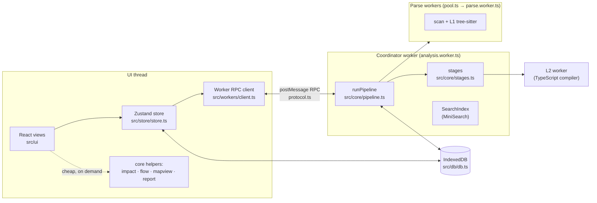

# Architecture

C-Ray is a **static site**. There is no backend: ingestion, parsing, analysis, persistence and export all
happen in the browser tab. The same analysis code also runs in Node for tests and benchmarks.

## Layers at a glance

## Directory map

| Path | Owns | Notes |
|---|---|---|
| `src/core/` | All analysis logic. **Isomorphic**: no DOM. | Runs in workers and in Node tests. |
| `src/core/types.ts` | The `Analysis` model and every shared type. | Bump `ANALYSIS_VERSION` on breaking shape changes. |
| `src/core/pipeline.ts` | `runPipeline`: ingest → per-file scan/L1 (cached) → L0 → plugged-in stages → snapshots. | Each stage wrapped in `time()`: failures become notices. |
| `src/core/stages.ts` | The ordered stage list (`defaultStages`) + `gitStage`. | Add new analysis here. |
| `src/core/ingest/` | Reading files/folders/ZIPs, ignore rules, binary/minified/generated detection, budgets. | Skips are recorded with a reason. |
| `src/core/l0/` | L0: languages, LOC, manifests, configs, docs, tech-stack detection. | No parsing needed. |
| `src/core/l1/` | L1: tree-sitter extraction (13 grammars) + heuristic import/call resolver. | Confidence `heuristic` unless proven. |
| `src/core/l2/tsgraph.ts` | L2: TypeScript compiler API program → exact defs/imports/refs for TS/JS. | Replaces L1 for those files (D13). |
| `src/core/graph.ts` | Stages `l1Stage`, `l2Stage`, `accuracyStage` (L1-vs-L2), `assembleStage`. | Builds `symbols / imports / refs`. |
| `src/core/detect/` | Framework detectors (Express, Fastify, Nest, Next, React, Django, Flask, FastAPI, Spring, Laravel, PHP pages, Rails, Go http, ASP.NET) + generic facts. | Regex/line scanners + symbol table (D15). |
| `src/core/flow.ts` | Request/flow tracer from an entry point. | Called by the UI on demand. |
| `src/core/schema.ts` | Data-model reconstruction from 11 ORM/DDL sources, ER → Mermaid, entity read/write map. | SQL via hand tokenizer (D3). |
| `src/core/deps.ts` | Cycles, coupling metrics, god modules, layering violations, packages. | |
| `src/core/health.ts`, `scan.ts` | Findings: size, complexity, nesting, clones, dead exports, TODOs, secrets, eval, SQL concat, TLS. | |
| `src/core/impact.ts` | Transitive dependents, affected entries/tests, risk score. | Called by the UI on demand. |
| `src/core/git/` | History from an uploaded `.git` via isomorphic-git over an in-memory FS: churn, authors, bus factor, co-change, snapshots, diff. | **M9, UI pending.** |
| `src/core/orientation.ts`, `roles.ts` | Summary, architecture-style guesses, "read these first", file roles. | Re-run after each phase. |
| `src/core/report.ts` | Markdown / Notion pages / diagrams for export. | |
| `src/core/search.ts` | Symbol + full-text search index. | Built lazily in the coordinator. |
| `src/core/node-env.ts` | Node implementation of the pipeline environment (tests/bench). | |
| `src/workers/` | `analysis.worker.ts` (coordinator), `pool.ts` + `parse.worker.ts` (parsing), `l2.worker.ts`, `protocol.ts`, `client.ts`. | |
| `src/db/db.ts` | IndexedDB stores: `projects`, `analyses`, `sources`, `cache`, `settings`, `handles`. | Retention + quota handling. |
| `src/store/store.ts` | Single Zustand store: app status, settings, current analysis, tab, source panel, cross-view focus. | |
| `src/ui/` | React views (one per tab), `kit.tsx` (shared components), `Graph.tsx` (Cytoscape), `Mermaid.tsx`, `SourcePanel.tsx`. | |
| `scripts/copy-assets.mjs` | Copies grammar WASMs + TS lib `.d.ts` into `public/` (pre-dev/build/install). | Generated, git-ignored. |
| `vite.config.ts` | Build + `offlinePlugin` that generates `sw.js` precaching all assets. | |
| `tests/` | `unit/` (Vitest, Node), `e2e/` (Playwright), `bench/`, `fixtures/` (6 planted-truth projects). | |

## Analysis model

`Analysis` (in `types.ts`) is one serialisable object per project. Key fields:
`files`, `skipped`, `coverage`, `l0`, `symbols`, `imports`, `refs`, `frameworks`, `routes`, `entries`, `facts`,
`schema`, `deps`, `findings`, `git`, `decisions` (M10, empty today), `orientation`, `notices`, `timings`, `stage`.

`stage` moves `l0 → graph → done`; the UI renders whatever is available (progressive snapshots).

### Analysis tiers and confidence

| Tier | Source | Confidence |
|---|---|---|
| L0 | File names, manifests, configs, text scan | `resolved` for declared facts, `heuristic` for inferred |
| L1 | tree-sitter syntax trees (all 13 languages) + name-based resolver | `heuristic` |
| L2 | TypeScript compiler API + type checker (TS/JS only, ≤4000 files) | `resolved` |
| L0-git | `.git` objects via isomorphic-git | `resolved` (history facts) |

Anything that cannot be determined statically is recorded as `unresolved`, never guessed.

## Stage order (`defaultStages`)

`graph` phase: `l1Stage` → `l2Stage` + `accuracyStage` (browser/with L2) → `assembleStage` → `detectStage` → `schemaStage` → `depsStage` → `healthStage`
`deep` phase: `gitStage`

(The `phase` field decides which snapshot a stage's output appears in.) Adding a stage = implement `Stage` and insert
it in `defaultStages`; it gets timing, error isolation and progress for free.

## Worker protocol (`protocol.ts`)

Requests: `analyze`, `reanalyze`, `open`, `source`, `search`, `occurrences`, `exportJson`, `close`.
Events streamed back during a request: `progress`, `snapshot`. Errors carry `userFacing` so the UI can show them as-is.
Cancel = terminate the coordinator worker (the client re-creates it).

## UI shell

`App` (header, banners) → `Home` (drop zone, settings, stored projects) or `ProjectView` (grouped side nav + current
view + `SourcePanel`). Tabs are declared in `TABS` in `ProjectView.tsx` with a `group` (Understand / Assess / Explore / Share);
`projectOnly` tabs are hidden in File Mode. Views read `analysis` from the store; cross-view navigation uses
`setTab(tab, focus)`.

## Persistence

Per project: metadata, the `Analysis`, sources (chunked; dropped first when quota is hit), and the per-file parse
cache keyed by content hash (incremental re-analysis). Project id = hash of the name (D5). Retention: 1d/7d/30d/forever.
Theme is in `localStorage` (D11).
