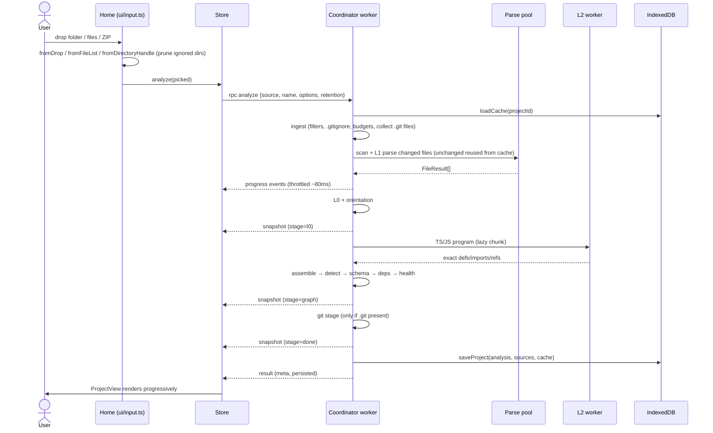

# Runtime flows

How data moves through C-Ray at runtime. Update when a flow changes.

## 1. Analyse a dropped project

Failure rules: a failing stage adds a notice and the run continues; an ingest failure (nothing analysable) returns a
user-facing error and Home shows the skipped list.

## 2. Re-analyse a stored project

`Home → reanalyze(id)`: if the browser still holds a `FileSystemDirectoryHandle` (permission re-granted), re-read the
folder; otherwise re-run on stored sources. Per-file hashes decide what is re-parsed; `Analysis.reused` reports it (D9).

## 3. Open a stored project

`openProject(id)` → `rpc open` → coordinator loads `Analysis` from IndexedDB and keeps it "active" → store sets
`analysis`. Sources and the search index are loaded lazily on first `source` / `search` request.

## 4. On-demand views (UI thread)

Impact (`core/impact.ts`), Flow tracing (`core/flow.ts`), System map layout (`core/mapview.ts`) and Export sections
(`core/report.ts`) are computed in the UI from the in-memory `Analysis`. They must stay bounded (caps, depth limits).
Source preview and search go through the worker (`source`, `search`, `occurrences`).

## 5. Export

Export view → `report.ts` builds sections → Markdown download, Notion ZIP (fflate), print/PDF view (Mermaid → SVG,
print stylesheet), or JSON (`rpc exportJson`, built in the worker).

## 6. Git history (M9)

`gitStage` → `analyzeGit(gitFiles)`: load `.git` into `MemFS` → walk commits (cap `maxGitCommits`) → churn, authors,
bus factor, co-change, message types → pick ≤10 snapshots (≤40 MB each) → re-run a light pipeline (L1 + assemble) per
snapshot, sharing parse results by blob hash → `analysis.git` + hotspot findings. No UI yet (see TODO M9).

## 7. Offline

Production build registers `sw.js` (generated by `offlinePlugin`) which precaches every built asset, including lazy
chunks (grammars, TS compiler, Mermaid). Same-origin GETs are cache-first; cross-origin requests are never touched.

## 8. Cancel

`cancel()` terminates the coordinator worker (and with it the pool and L2 worker). The client creates a fresh worker
on the next request. Nothing partial is persisted.
